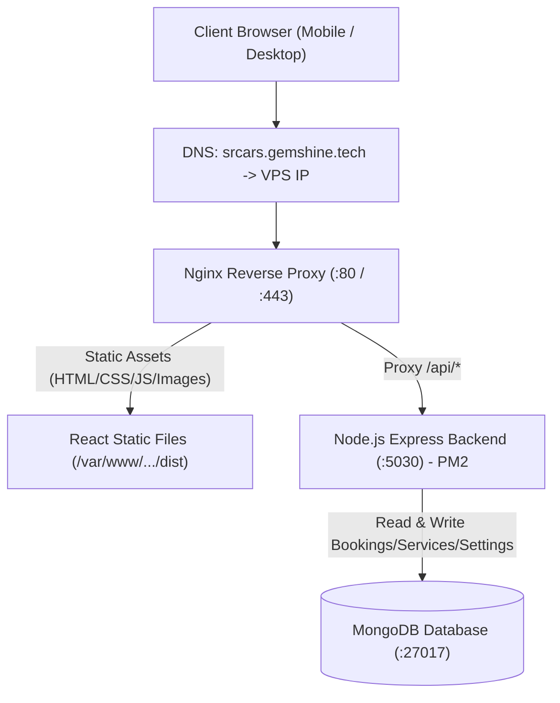

# 🚀 CAR CARE LUXURY DETAILING - VPS DEPLOYMENT GUIDE
**Subdomain**: `srcars.gemshine.tech`  
**Backend API Port**: `5030`  
**Database**: MongoDB (Local VPS / Atlas)  
**Process Manager**: PM2  
**Reverse Proxy**: Nginx with SSL (Let's Encrypt Certbot)  

---

## 📌 Architecture Overview



---

## 🛠️ Step 1: DNS Configuration (In your Domain Registrar / Cloudflare)

Go to your domain provider (e.g., Cloudflare, GoDaddy, Hostinger, Namecheap) for `gemshine.tech`:
1. Add an **A Record**:
   - **Type**: `A`
   - **Name**: `srcars` (subdomain: `srcars.gemshine.tech`)
   - **IPv4 Address**: `YOUR_VPS_PUBLIC_IP`
   - **TTL**: Auto or 1 hour
2. Wait 2–5 minutes for DNS propagation. You can verify on your terminal:
   ```bash
   ping srcars.gemshine.tech
   ```

---

## 🛠️ Step 2: Connect to Your VPS

Open your terminal or PowerShell and SSH into your VPS:
```bash
ssh root@YOUR_VPS_IP
```

---

## 🛠️ Step 3: Install MongoDB on VPS

Run our automated MongoDB setup script:
```bash
cd /var/www  # or your preferred directory
git clone <your-repo-url> car-care
cd car-care

# Run the automated MongoDB installer
sudo bash scripts/setup_mongodb.sh
```

### Manual MongoDB Commands (Ubuntu 22.04 / 20.04):
```bash
sudo apt-get update
sudo apt-get install -y gnupg curl

curl -fsSL https://www.mongodb.org/static/pgp/server-7.0.asc | \
   sudo gpg -o /usr/share/keyrings/mongodb-server-7.0.gpg --dearmor --yes

echo "deb [ arch=amd64,arm64 signed-by=/usr/share/keyrings/mongodb-server-7.0.gpg ] https://repo.mongodb.org/apt/ubuntu $(lsb_release -cs)/mongodb-org/7.0 multiverse" | sudo tee /etc/apt/sources.list.d/mongodb-org-7.0.list

sudo apt-get update
sudo apt-get install -y mongodb-org

# Start and Enable on boot:
sudo systemctl start mongod
sudo systemctl enable mongod

# Verify running:
sudo systemctl status mongod
```

The database connection URI is:
```env
MONGODB_URI=mongodb://127.0.0.1:27017/car_care
```

---

## 🛠️ Step 4: Configure Environment Variables

Create or verify `server/.env` inside `server/`:
```bash
nano server/.env
```
Ensure it contains:
```env
PORT=5030
NODE_ENV=production
MONGODB_URI=mongodb://127.0.0.1:27017/car_care
APP_URL=https://srcars.gemshine.tech
```
Save with `Ctrl + O` and exit with `Ctrl + X`.

---

## 🛠️ Step 5: One-Command Automated Deployment

We have included a complete deployment script:
```bash
bash scripts/deploy.sh
```

This script will automatically:
1. Install Node.js LTS (v20) and PM2 if missing.
2. Run `npm install` for root and `server/`.
3. Build the production React frontend bundle with `npm run build`.
4. Copy the compiled `dist/` directory to `/var/www/srcars.gemshine.tech/dist`.
5. Start the Node.js Express server on **Port 5030** using PM2 with auto-restart.
6. Configure Nginx reverse proxy for `srcars.gemshine.tech` and reload Nginx.

---

## 🔒 Step 6: Setup Free HTTPS / SSL with Certbot

Once your domain `srcars.gemshine.tech` points to your VPS IP:
```bash
sudo certbot --nginx -d srcars.gemshine.tech
```
- Enter your email address for renewal alerts.
- Agree to terms (`Y`).
- Certbot will automatically issue the SSL certificate and update Nginx!

---

## 📊 Useful PM2 Commands

| Command | Action |
| :--- | :--- |
| `pm2 status` | Check status of running backend app |
| `pm2 logs car-care-app` | View real-time server and MongoDB logs |
| `pm2 restart car-care-app` | Restart backend server |
| `pm2 reload car-care-app` | Zero-downtime reload |
| `pm2 stop car-care-app` | Stop application |

---

## 🔍 Health & Connectivity Verification

1. Test Backend API on port 5030:
   ```bash
   curl http://127.0.0.1:5030/api/health
   ```
   **Expected Response:**
   ```json
   {
     "status": "ok",
     "server": "running",
     "port": 5030,
     "database": "MongoDB Atlas (Connected)",
     "timestamp": "2026-11-17T..."
   }
   ```

2. Test Services API:
   ```bash
   curl http://127.0.0.1:5030/api/services
   ```

3. Open in Browser:
   - **Frontend & Booking**: `https://srcars.gemshine.tech`
   - **Admin Command Center**: `https://srcars.gemshine.tech` -> Click **Admin Console** or go to `#admin` (Default: `admin` / `admin123`)
